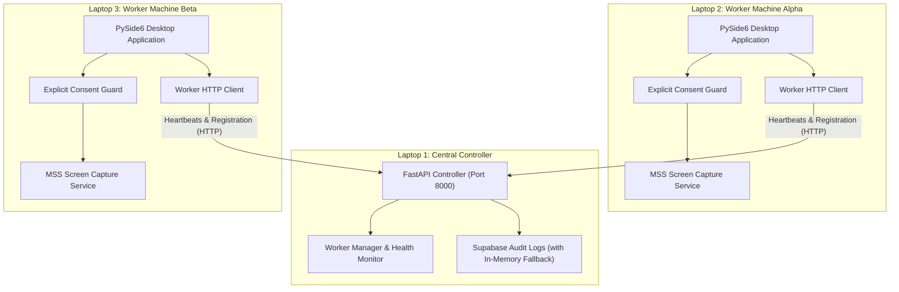

# NIAT CodePilot

**NIAT CodePilot** is a distributed desktop AI coding assistant designed for collaborative, multi-machine educational environments. In this architecture:
- **Laptop 1 (Controller)**: Central coordinator running a FastAPI backend that registers worker nodes, monitors real-time health heartbeats, coordinates tasks, and provides administrative oversight.
- **Laptop 2 & Laptop 3 (Workers)**: Independent worker machines running PySide6 desktop applications capable of capturing permitted screen regions with **explicit student consent**, transmitting frames for AI coding guidance, and presenting explanations.

---

## 🛡️ Ethics, Privacy & Security Commitments

NIAT CodePilot strictly enforces the following security boundaries across all components:

1. **Explicit Permission Required for Screen Capture**:
   - The screen capture engine will **refuse to capture any frames** unless the student has explicitly checked the consent agreement in the desktop UI (`REQUIRE_EXPLICIT_PERMISSION=true`).
   - Screen capture can be revoked at any instant or halted immediately via the Emergency Stop button.
2. **Never Hardcode Credentials**:
   - All credentials (OpenAI API keys, Supabase URLs, secret tokens) are loaded strictly via environment variables or a local `.env` file.
3. **No Student Password Storage**:
   - The application does not solicit, log, or persist user passwords or institutional credentials.
4. **No Automated Portal Submissions**:
   - The platform strictly forbids bot-like automated submissions, anti-bot circumvention, or clandestine web automation.
5. **Student Approval for Consequential Actions**:
   - All AI-generated explanations, advice, and suggested code diffs must be manually reviewed, accepted, or applied by the student.

---

## 📐 System Architecture



---

## 📁 Project Structure

```
niat-codepilot/
├── .env.example                # Environment variables template
├── README.md                   # System documentation & setup guide
├── pyproject.toml              # Build & dependency metadata
├── requirements.txt            # Python package requirements
├── scripts/
│   ├── run_controller.py       # Central controller CLI launcher
│   └── run_worker.py           # Worker desktop application launcher
├── src/
│   ├── common/
│   │   ├── config.py           # Pydantic Settings & environment loader
│   │   ├── constants.py        # Worker statuses, commands, and ethical policies
│   │   ├── logger.py           # Structured logging
│   │   └── schemas.py          # Pydantic data models & contracts
│   ├── controller/
│   │   ├── db.py               # Supabase database integration & local fallback
│   │   ├── manager.py          # Worker lifecycle, heartbeat tracker & stale reaper
│   │   ├── main.py             # FastAPI app factory and background lifespan
│   │   └── routes/
│   │       ├── health.py       # Health check endpoint
│   │       ├── workers.py      # Registration, heartbeat, status & emergency stops
│   │       └── tasks.py        # Safe task queue & anti-submission enforcement
│   ├── worker/
│   │   ├── capture.py          # MSS screen capture with explicit consent guards
│   │   ├── client.py           # Async HTTP client communicating with Controller
│   │   └── ai_engine.py        # OpenAI API vision/reasoning service
│   └── desktop/
│       ├── main.py             # PySide6 desktop client entrypoint
│       ├── app.py              # MainWindow with Start, Stop, Emergency Stop, Consent & Preview
│       └── components/
│           ├── preview_widget.py # Live/snapshot screen capture display
│           └── status_bar.py     # Connection, permission & heartbeat status pills
└── tests/
    ├── test_schemas.py         # Schema validation unit tests
    ├── test_screen_capture.py  # MSS permission and emergency stop unit tests
    ├── test_worker_manager.py  # Worker state & stale reaper tests
    └── test_controller_api.py  # FastAPI integration & security route tests
```

---

## 💻 Windows 10 Installation & Quickstart

### Prerequisites
- Windows 10 (or 11) 64-bit
- Python 3.12 or 3.13 installed ([python.org](https://www.python.org/downloads/))
  *Ensure **"Add Python to PATH"** is checked during installation.*
- All three laptops connected to the same Local Area Network (Wi-Fi or Ethernet router).

---

### Step 1: Clone or Copy the Repository
Open PowerShell or Command Prompt on all laptops and navigate to the project directory:
```powershell
cd "D:\NIAT copolit"
```

### Step 2: Create a Virtual Environment & Install Dependencies
On each laptop:
```powershell
python -m venv .venv
.\.venv\Scripts\Activate.ps1
pip install -r requirements.txt
```

### Step 3: Configure Environment Variables
Copy `.env.example` to `.env`:
```powershell
Copy-Item .env.example .env
```

If you plan to use OpenAI or Supabase, open `.env` in Notepad and insert your credentials:
```ini
OPENAI_API_KEY=sk-...
SUPABASE_URL=https://your-project.supabase.co
SUPABASE_KEY=your-supabase-key
```
*(If omitted, NIAT CodePilot automatically operates in local memory fallback mode).*

---

## 🚀 Running the System

### Machine 1: Central Controller Laptop

1. Find the local IPv4 address of Laptop 1:
   ```powershell
   ipconfig
   ```
   *Look for `IPv4 Address`, for example: `192.168.1.100`.*

2. Launch the Central Controller:
   ```powershell
   python scripts\run_controller.py --host 0.0.0.0 --port 8000
   ```
   *The controller will start and bind to `http://0.0.0.0:8000`.*
   You can verify it in your browser at `http://localhost:8000/health` or `http://localhost:8000/docs` (interactive Swagger UI).

---

### Machine 2: Worker Laptop 1 (Alpha)

Launch Worker 1 pointing to the Controller IP:
```powershell
python scripts\run_worker.py --id worker-laptop-01 --name "Worker Alpha" --controller http://192.168.1.100:8000
```

1. The desktop interface will open.
2. Verify the **Worker ID** and **Controller URL**.
3. Check the **Explicit Consent** box:
   *`"I EXPLICITLY GRANT PERMISSION for NIAT CodePilot to capture my screen..."`*
4. Click **"▶ Start Worker & Capture"**:
   - The worker registers with Laptop 1.
   - Heartbeats begin pulsing every 5 seconds.
   - Screen capture initializes.
5. Click **"📷 Capture Single Preview"** or observe the live preview pane.

---

### Machine 3: Worker Laptop 2 (Beta)

Launch Worker 2 on the third laptop:
```powershell
python scripts\run_worker.py --id worker-laptop-02 --name "Worker Beta" --controller http://192.168.1.100:8000
```

Repeat the consent and start steps. Both workers will now appear registered and monitored on the central controller.

---

## 🚨 Emergency Stop Controls

- **Worker Desktop UI**:
  Clicking the large red **"🚨 EMERGENCY STOP"** button immediately:
  1. Revokes the user permission flag.
  2. Aborts active screen capturing in MSS.
  3. Halts background heartbeat routines.
  4. Flushes the screen preview buffer and watermarks the UI as stopped.
- **Controller Remote Emergency Stop**:
  The controller can remotely trigger an emergency halt across any or all workers via the API:
  ```powershell
  curl -X POST http://localhost:8000/api/v1/workers/emergency-stop
  ```
  On the next heartbeat pulse, the worker receives the `EMERGENCY_STOP` command and immediately disables all capture and processing.

---

## 🧪 Running Unit Tests

Run the full automated test suite using `pytest`:
```powershell
pytest -v
```

All 16 unit tests cover:
- Pydantic schema validation & bounds checking
- Screen capture permission guards and emergency halt mechanics
- Central worker manager lifecycle, registration, and stale reaper
- FastAPI routes, registration flows, heartbeats, and anti-bot submission blocks
