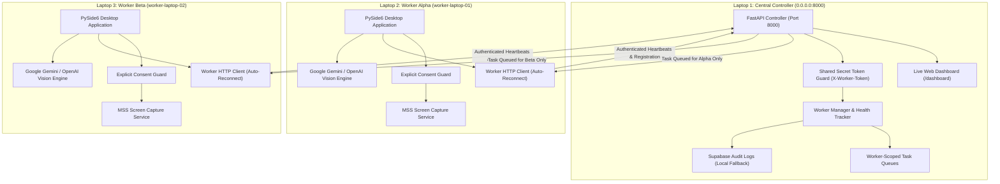

# NIAT CodePilot

**NIAT CodePilot** is a distributed desktop AI coding assistant designed for collaborative, multi-machine educational environments. In this architecture:
- **Laptop 1 (Controller)**: Central coordinator running a FastAPI backend on LAN (`0.0.0.0:8000`) that authenticates and registers worker nodes, tracks real-time health heartbeats, coordinates worker-isolated tasks, and provides an interactive live web dashboard.
- **Laptop 2 (Worker Alpha)**: Independent worker machine (`worker-laptop-01`) running the PySide6 desktop application capable of capturing permitted screen regions with **explicit student consent**, transmitting frames for AI coding guidance, and presenting explanations.
- **Laptop 3 (Worker Beta)**: Independent worker machine (`worker-laptop-02`) running concurrently on the same network with unique identity, isolated task queues, and independent screen capture consent.

---

## 🛡️ Ethics, Privacy & Security Commitments

NIAT CodePilot strictly enforces the following security boundaries across all components:

1. **Explicit Permission Required for Screen Capture**:
   - The screen capture engine will **refuse to capture any frames** unless the student has explicitly checked the consent agreement in the desktop UI (`REQUIRE_EXPLICIT_PERMISSION=true`).
   - Screen capture can be revoked at any instant or halted immediately via the Emergency Stop button.
2. **Never Hardcode Credentials & Authenticated Registration**:
   - All credentials (OpenAI / Gemini API keys, Supabase URLs, shared controller secrets) are loaded strictly via environment variables or a local `.env` file.
   - Worker registration and heartbeats require a shared secret key (`CONTROLLER_SECRET_KEY`).
3. **No Student Password Storage**:
   - The application does not solicit, log, or persist user passwords or institutional credentials.
4. **No Automated Portal Submissions**:
   - The platform strictly forbids bot-like automated submissions, anti-bot circumvention, or clandestine web automation.
5. **Student Approval for Consequential Actions**:
   - All AI-generated explanations, advice, and suggested code diffs must be manually reviewed, accepted, or applied by the student.
6. **Task & Identity Isolation**:
   - Unique worker IDs prevent identity conflicts. Tasks assigned to Worker Alpha can never be polled or executed by Worker Beta.
7. **Zero Exposure of Secrets in Logs and Dashboard**:
   - API keys, student credentials, and screenshot image payloads are never exposed on the web dashboard or recorded in audit logs.

---

## 📐 System Architecture



---

## 🌐 Network Requirements for 3-Laptop Wi-Fi Setup

1. **Same Wi-Fi Router / Mobile Hotspot**:
   - All three laptops must connect to the same local Wi-Fi network (or router Ethernet).
   - Ensure the Wi-Fi network profile on Windows is set to **Private Network** (not Public) so machines can discover each other.
2. **Laptop 1 (Controller) Port 8000 Accessibility**:
   - The central controller listens on `0.0.0.0:8000` (all network adapters).
   - Windows Defender Firewall on Laptop 1 must allow inbound TCP connections on port 8000.
3. **Shared Secret Token**:
   - All three laptops must share the same `CONTROLLER_SECRET_KEY` in their `.env` file (or via the desktop UI / CLI parameter).

---

## 💻 Windows 10/11 Step-by-Step PowerShell Setup

### Step 1: Clone or Copy Repository to All 3 Laptops

Open PowerShell as Administrator on each laptop:
```powershell
cd "D:\NIAT copolit"
```

### Step 2: Set Up Virtual Environment & Dependencies

Run this on all three laptops:
```powershell
# Create Python virtual environment
python -m venv .venv

# Activate virtual environment
.\.venv\Scripts\Activate.ps1

# Install requirements
pip install -r requirements.txt
```

---

### Step 3: Configure Laptop 1 (Central Controller)

1. **Find Laptop 1's LAN IP Address**:
   In PowerShell on Laptop 1:
   ```powershell
   (Get-NetIPAddress -AddressFamily IPv4 -InterfaceAlias "Wi-Fi*").IPAddress
   # Alternatively:
   ipconfig
   ```
   *Example output: `192.168.1.100` — note this IP address!*

2. **Allow Port 8000 through Windows Firewall on Laptop 1**:
   Run in an elevated PowerShell on Laptop 1:
   ```powershell
   New-NetFirewallRule -DisplayName "NIAT CodePilot Controller" -Direction Inbound -LocalPort 8000 -Protocol TCP -Action Allow
   ```

3. **Configure `.env` on Laptop 1**:
   ```powershell
   Copy-Item .env.example .env
   ```
   Edit `.env` and configure:
   ```ini
   CONTROLLER_HOST=0.0.0.0
   CONTROLLER_PORT=8000
   CONTROLLER_SECRET_KEY=niat-secure-shared-key-2026
   AI_PROVIDER=gemini
   GEMINI_API_KEY=your-gemini-key
   GEMINI_MODEL=gemini-flash-lite-latest
   ```

4. **Launch the Controller**:
   ```powershell
   python scripts\run_controller.py --host 0.0.0.0 --port 8000
   ```

5. **Open the Central Web Dashboard**:
   Open your browser on Laptop 1 (or any browser on the LAN):
   - **Dashboard**: `http://localhost:8000/dashboard` (or `http://192.168.1.100:8000/dashboard`)
   - **Interactive API Docs**: `http://localhost:8000/docs`
   - **Health Check**: `http://localhost:8000/health`

---

### Step 4: Configure Laptop 2 (Worker Alpha)

1. **Configure `.env` on Laptop 2**:
   ```powershell
   Copy-Item .env.example .env
   ```
   Set:
   ```ini
   CONTROLLER_URL=http://192.168.1.100:8000
   CONTROLLER_SECRET_KEY=niat-secure-shared-key-2026
   WORKER_ID=worker-laptop-01
   WORKER_NAME=Worker Alpha
   AI_PROVIDER=gemini
   GEMINI_API_KEY=your-gemini-key
   GEMINI_MODEL=gemini-flash-lite-latest
   ```

2. **Launch Worker Alpha**:
   ```powershell
   python scripts\run_worker.py --id worker-laptop-01 --name "Worker Alpha" --controller http://192.168.1.100:8000
   ```

3. **In the PySide6 Desktop GUI**:
   - Confirm Worker ID is `worker-laptop-01` and Controller URL is `http://192.168.1.100:8000`.
   - Check the **"I EXPLICITLY GRANT PERMISSION..."** consent box.
   - Click **"▶ Start Worker & Capture"**.
   - Notice the status bar turns green (`Controller: Connected (ID: worker-laptop-01)`).
   - Check Laptop 1's Dashboard: **Worker Alpha** appears immediately with real-time CPU/RAM gauges and heartbeat count!

---

### Step 5: Configure Laptop 3 (Worker Beta)

1. **Configure `.env` on Laptop 3**:
   ```powershell
   Copy-Item .env.example .env
   ```
   Set:
   ```ini
   CONTROLLER_URL=http://192.168.1.100:8000
   CONTROLLER_SECRET_KEY=niat-secure-shared-key-2026
   WORKER_ID=worker-laptop-02
   WORKER_NAME=Worker Beta
   AI_PROVIDER=gemini
   GEMINI_API_KEY=your-gemini-key
   GEMINI_MODEL=gemini-flash-lite-latest
   ```

2. **Launch Worker Beta**:
   ```powershell
   python scripts\run_worker.py --id worker-laptop-02 --name "Worker Beta" --controller http://192.168.1.100:8000
   ```

3. **In the PySide6 Desktop GUI**:
   - Check the **"I EXPLICITLY GRANT PERMISSION..."** consent box.
   - Click **"▶ Start Worker & Capture"**.
   - Laptop 1's Dashboard now displays **both Worker Alpha and Worker Beta** simultaneously in real-time!

---

## 📡 Fault Tolerance & Reconnection

- **Automatic Reconnection**:
  If the Wi-Fi connection drops or the controller restarts, the worker client detects the network disruption, marks its status as `RECONNECTING`, and automatically re-registers with the controller using exponential backoff once the network recovers.
- **Heartbeat Expiry & Stale Reaper**:
  If a worker loses power or disconnects without stopping, the controller marks it `OFFLINE` after 15 seconds of inactivity.
- **Duplicate Worker ID Prevention**:
  If another machine attempts to register with an already-active worker ID (`worker-laptop-01`), the controller rejects the conflicting registration with `409 Conflict`.
- **Worker-Isolated Task Queuing**:
  Tasks assigned to `worker-laptop-01` are held in an isolated queue that only `worker-laptop-01` can poll.

---

## 🚨 Emergency Stop Controls

- **Worker Desktop UI**:
  Clicking the large red **"🚨 EMERGENCY STOP"** button immediately revokes permission, aborts MSS screen capture, halts heartbeats, and flushes the preview buffer.
- **Controller Dashboard Emergency Stop**:
  The operator sitting at Laptop 1 can click **"Halt Worker"** on any worker card or click **"🛑 EMERGENCY STOP ALL"** to immediately issue a halt command across all connected laptops.

---

## 🧪 Automated Test Suite

Run the complete test suite using `pytest`:
```powershell
pytest -v
```

All **57 automated tests** pass:
- **Distributed Deployment & LAN Tests (`tests/test_distributed_deployment.py`)**:
  - Two-worker concurrent registration (Worker Alpha + Worker Beta).
  - Shared secret authentication enforcement and rejection (401).
  - Duplicate worker ID conflict prevention across different hosts (409).
  - Same-host reconnection and session renewal.
  - Heartbeat expiry and stale worker reaping.
  - Worker client auto-reconnection resilience.
  - Worker-scoped task queue isolation.
  - Multi-worker remote emergency stop.
  - Central controller web dashboard endpoints.
- **Controller API & Security (`tests/test_controller_api.py`)**:
  - Health checks, registration flows, heartbeat pulses, anti-bot submission prevention.
- **Worker Management (`tests/test_worker_manager.py`)**:
  - State tracking, metrics collection, and emergency commands.
- **Screen Capture & Permission Guard (`tests/test_screen_capture.py`)**:
  - Explicit consent enforcement, preview frames, emergency halt.
- **AI Vision Engine & PII Scrubbing (`tests/test_ai_engine.py`)**:
  - Google Gemini multimodal vision pipeline, synthetic coding-problem integration test, prompt sanitization, error handling, structured Pydantic response parsing.
- **Pydantic Schemas (`tests/test_schemas.py`)**:
  - Data contracts and payload validation.
